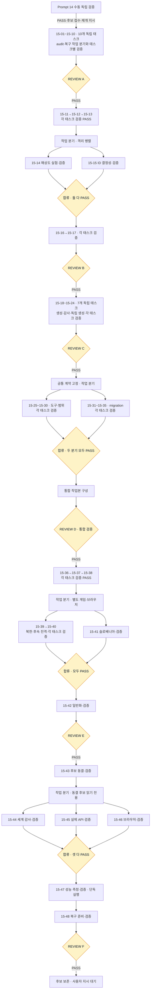
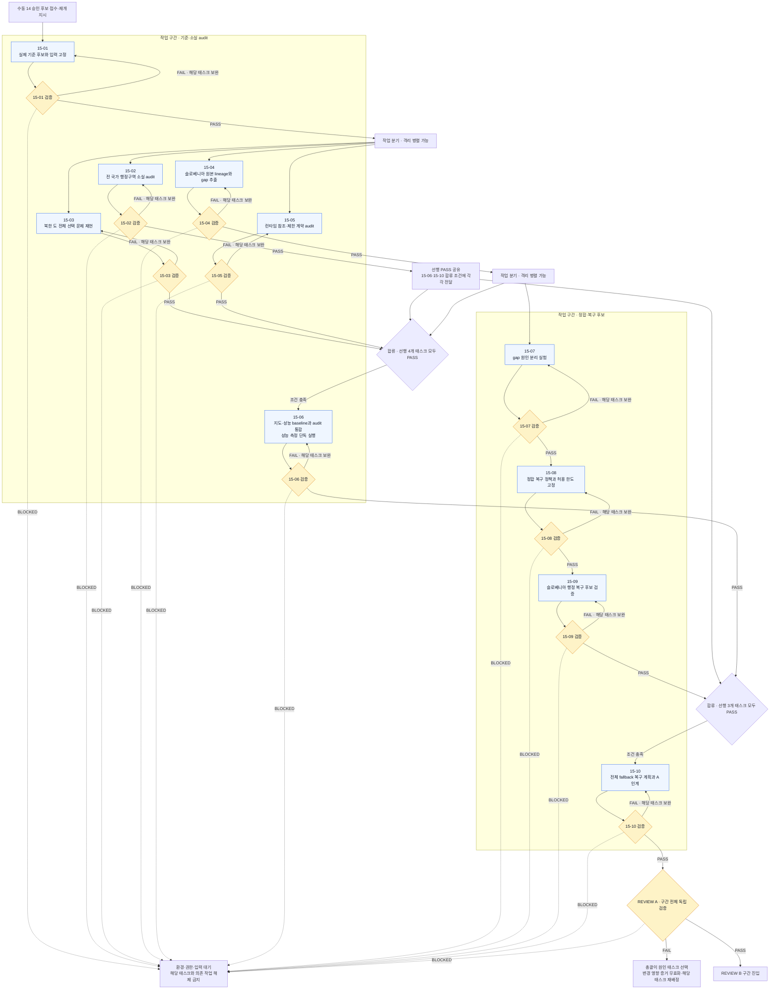
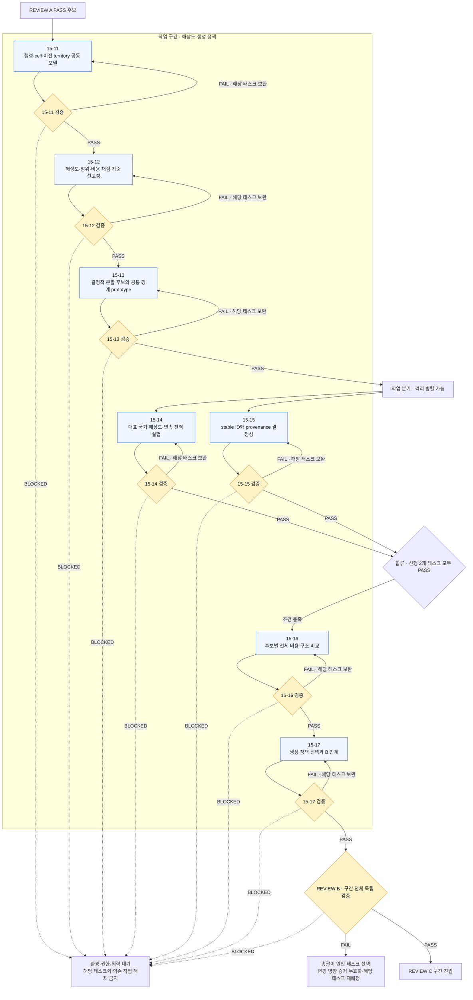
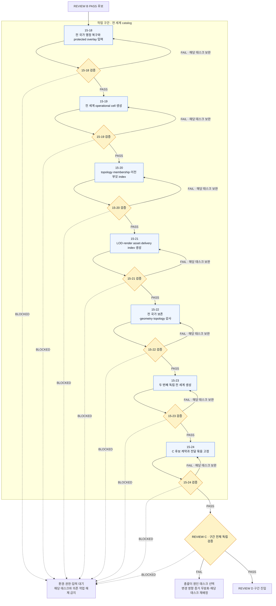
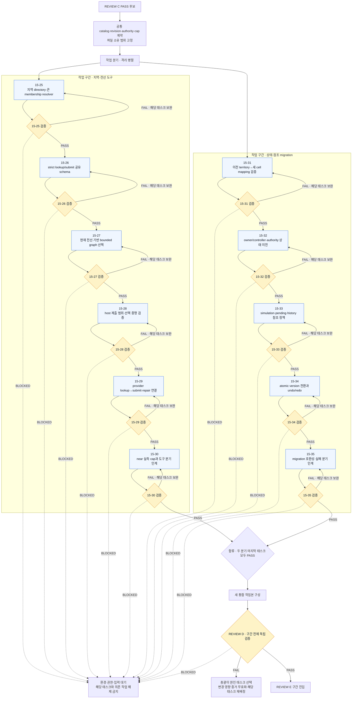
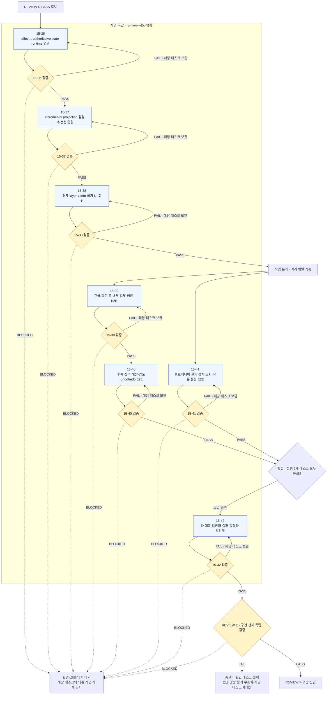
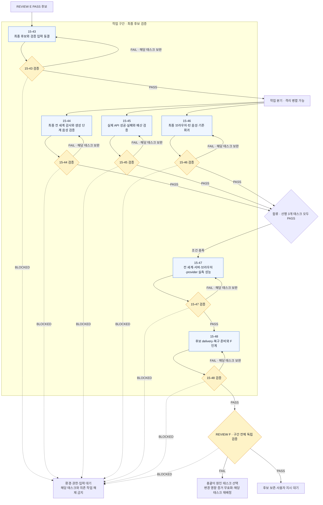
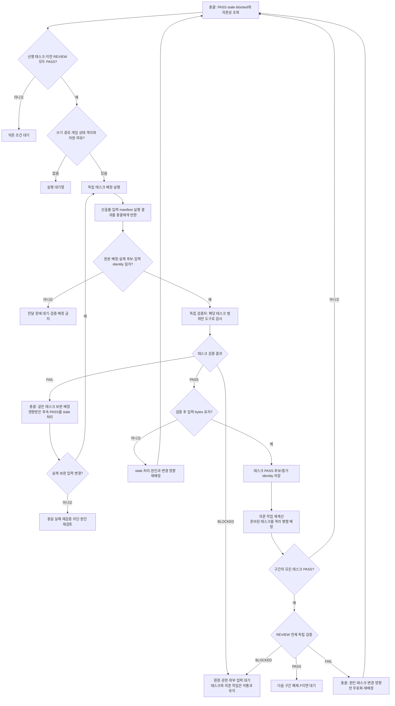

# Prompt 15 총괄 구현 검증 운영 v12

현재 모드는 `manual-prompt14`다. Prompt 14는 별도 창에서 수동 독립 검증하며 이 오케스트레이션은 자동 실행하지 않는다. 자동 14 보완 루프는 폐기했다. 과거 run·판정·후보·배정 기록은 보존한다.

## 실행 경계

`automation/prompt15/config.json`의 실행 모드가 수동이면 `run.mjs start/resume`과 runtime wrapper는 run 생성·latest 변경·retry 기록·app-server/model 호출 전에 거부한다. 실행 중 수동 모드 전환/stop은 해당 컨트롤러의 turn만 중단한다. 수동 결과 접수 자체는 실행을 허가하지 않는다.

14 PASS 뒤 사용자가 재개를 지시하면 독립 검증 결과와 후보를 명시적으로 접수하고 새 run을 A부터 시작한다. 과거 baselinePending run을 자동 변환하거나 네 번의 FAIL을 PASS로 덮어쓰지 않는다. F 통과 후에는 대기하며 게시·cutover·Prompt 16을 시작하지 않는다.

## 48개 독립 태스크의 목표 실행 계약

실행 태스크는 15-01~15-48이다. 기존 8개 checkpoint는 작업 구간이고 최종 통합 승인 경계는 REVIEW A~F다. 태스크마다 별도 배정·보고·독립 검증·재개를 수행하고 PASS일 때만 의존 작업을 해제한다. FAIL은 같은 태스크 보완, BLOCKED는 해당 태스크와 의존 작업 대기다.

현재 실행기는 implementationUnit=review인 기존 모드다. 48개 태스크 스케줄러는 아직 반영되지 않았으며 자동 실행은 manual-prompt14로 정지한다. 아래 도식은 재개 전에 실행기에 반영할 목표 설계다.



## 태스크별 검증·병렬 작업·합류

각 태스크 검증의 PASS 경로만 다음 태스크로 이어진다. 병렬 작업은 모든 의존 PASS·소유 범위 비중복·게임/브라우저/출력 격리 조건을 만족할 때 최대 2개를 실행한다. baseline 측정 태스크 15-06과 최종 성능 태스크 15-47은 단독 실행한다. 합류는 모든 선행 태스크의 현재 PASS를 기다린다.

### REVIEW A · 10개 독립 태스크



### REVIEW B · 7개 독립 태스크



### REVIEW C · 7개 독립 태스크



### REVIEW D · 11개 독립 태스크



### REVIEW E · 7개 독립 태스크



### REVIEW F · 6개 독립 태스크



## 태스크 검증·보완·재개



## 세 경로와 후보 승인

| 항목 | 역할 |
| --- | --- |
| controlRoot/projectRoot | 운영 코드·정책·run·보고서 저장소. 제품 검사 대상으로 대체 금지 |
| productRoot/candidateRoot | 실제 구현·import·빌드·검증의 제품 경로 |
| reportDirectory | 이번 독립 검증의 새 증거 위치 |

컨트롤러는 배정한 실제 작업본의 source/config/e2e/validation 목록과 추가 제품 입력을 고정한다. target.json은 원본 배정 identity, 확정된 구현 turn/response identity, product-inputs manifest, revision, targetId를 연결한다. completed/blocked 모두 같은 전달 계약을 사용한다. 모델의 자유로운 경로 보고나 요약만으로 후보를 선택하지 않는다. 누락·변조·경로 불일치는 handoff 장애로 중단하며 원본으로 fallback하지 않는다.

승인 후보는 불변이다. 새 REVIEW는 소스만 복사하고 data/public/node_modules 및 승인 reports/prompt14는 읽기 전용 공유한다. 변조 fixture는 명시한 소수 파일만 복사한다. 리뷰로 되돌아가면 승인본을 fork하고 후속 작업본 포인터를 폐기하되 실제 파일과 이력은 보존한다. 15-5/15-6은 서로 겹치지 않는 소유 경로에서 구현하며 병합 대상은 D의 새 통합 작업본이다.

독립 PASS에는 실제 candidateRoot/targetId와 manifest attestation이 필요하다. stage journal은 후보 source를 자동 pin하고 controlRoot의 src·제품 scripts·package/config를 검사 입력으로 선택하면 거부한다. PASS certificate도 그 후보를 참조한다. 다음 리뷰는 이 승인 후보에서 시작한다. B24개국·C 원문 독립 생성·E/F 실제 브라우저 등 원문 필수 범위는 유지한다.

## 실패 집계와 복구

관측된 검증 결과 수와 고유 구현 실패 수를 구별한다. 실패 키는 REVIEW + 실제 후보 revision + 실패 gate다. 폴더·jobId·보고서 이름이 달라져도 같은 입력의 실패는 한 번 집계한다. 수정했다고 보고했지만 실패 revision이 그대로면 새 검증 모델을 호출하지 않고 handoff 장애로 대기한다. 환경·전달·외부 권한 차단은 구현 스트라이크가 아니다.

확정된 구현/검증 turn은 원본 요청·schema·cwd·완료 응답과 연결하여 저장한다. 완료 보고 저장 후 중단되면 그 보고를 전달하고, 검증 응답 저장 후 중단되면 고정 입력과 journal을 다시 대조해 판정을 게시한다. 이미 확인된 turn을 다시 실행하지 않는다. 완료 응답이 없는 불확실한 작업은 완료로 추정하지 않는다. 런타임 복구는 최대 다섯 번 뒤 운영 대기로 전환하며 사용자 중단·수동 모드는 자동 해제하지 않는다.

3스트라이크는 서로 다른 실제 구현 실패에 적용한다. 총괄은 다른 접근과 구체적 보완 계획을 작성하고 기록한다. 작은 태스크 PASS·실행 도구 장애·단순 재시도는 REVIEW 실패 누적을 초기화하지 않는다. 과거 네 번의 baseline 판정은 삭제하지 않고 별도 감사 기록으로 중복 관측 관계를 설명한다.

## 14 수동 결과 접수

접수 도구는 모델·네트워크를 호출하지 않는다. 수동 독립 결과는 review=prompt14, verdict=pass와 필수 다섯 gate(typecheck, production_build, handler_contracts, catalog_identity, browser_regressions), 실제 commands/exitCode, evidence identity, inputs identity를 갖춘 기계 판정 파일이어야 한다. 기존 수동 보고 형식이 다르면 원본 보고를 보존하고 그 증거를 참조하는 명시적 판정 파일로 정리한다. PASS 문자열이나 구현자의 자체 보고만으로 접수하지 않는다.

공통 입력을 별도 파일에 보관했다면 verdict.inputs에 그 파일 identity를 넣고 verdict.inputManifests에도 같은 identity를 기록한다. 각 공통 파일은 version=1, inputs=[{path,sha256,byteLength}] 형식이다. 실제 후보의 모든 고정 source 입력과 현재 공유 입력을 대조하며 누락·변조·미실행이 있으면 접수하지 않는다.

```text
node scripts/prompt15-orchestrator/adopt-manual-baseline.mjs <독립판정.json> <실제후보> <새접수보고폴더>
```

명령은 baseline-receipt.json만 작성하며 executionMode를 변경하지 않는다. 수동 PASS와 사용자 재개 지시가 확인된 뒤 운영 담당자가 manualBaselineReceipt를 연결하고 executionMode=orchestrated로 전환한다. 이 문서 수정 작업에서는 접수·실행하지 않는다.

## 운영 코드와 제품 검증의 분리

총괄·구현·검증은 각각 독립 root thread를 유지하며 대화 이력을 복사/fork하지 않는다. 모든 전달은 총괄을 거친다. 제품 역할은 운영 코드·다른 세션을 수정하지 않는다. 전달 문제는 운영 담당자가 별도로 보완하며 제품 재구현을 반복 배정하지 않는다.

제어 도구 자체는 node:test의 소형 실제 filesystem fixture로 검증한다. 제품은 Vitest/fast-check, 실제 CLI, Playwright를 사용한다. 제어 self-test PASS를 제품 REVIEW 승인으로 취급하지 않는다. 입력 manifest는 한 번 저장하고 참조하며 명령 로그는 스트림당 256 KiB 이하로 보관한다. 사고·heartbeat는 실행 완료 증거가 아니다. 검증 turn에서 실제 도구 실행 없이 15분이 지나면 자기 turn만 interrupt하고 환경 timeout으로 기록한다. 실행 중인 실제 명령은 idle로 오인하지 않는다.

v12 제품 테스트 러너는 `run-target-checks.mjs <job-context.json> <이번 job 안의 새 결과폴더> <명시한 파일...> [--environment node|jsdom]`다. 실제 후보의 @ alias와 UI setup을 사용하고 독립 테스트는 검증 보고서 안에서 작성한다. stage의 실제 cwd는 productRoot이며 command argv의 파일·증거 경로는 절대 경로로 지정한다. 원본 저장소의 package/source를 테스트 대상으로 선택하지 않는다. 빌드용 복사본은 검증 폴더 안에 두고 후보와 source/config bytes의 대응을 검사한다. 이 러너의 PASS는 명시한 테스트 범위에만 유효하다.

주요 구현: product-target.mjs(후보/배정 계약), launch-policy.mjs(수동 gate/접수), workflow.mjs(단계/후보 전달/복구), verification-stages-compact.mjs(고정 후보 journal), policy.mjs(집계/오류 분류), workspaces.mjs(격리/소유/병합). 레거시 v9/v10 journal은 기존 이력 호환용으로 유지한다.
