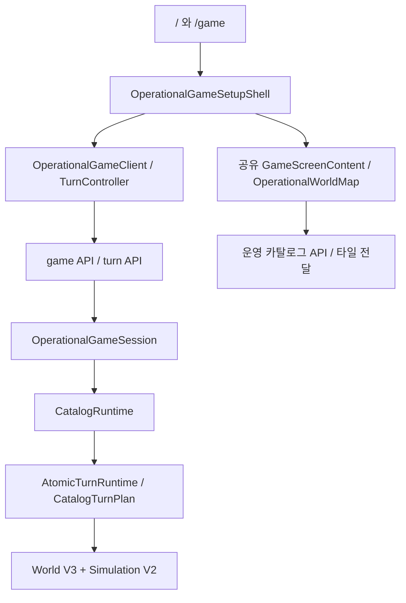

# Prompt 15~16 코드 종합 분석 — 2026-10-29

정리 결과를 **c7eb273198925d5f12ce1b0946174e86f1e3f0f4**로 origin/main에 먼저 push하고 원격 일치를 확인한 뒤 분석했다. 이번 분석에서 앱 소스를 수정하거나 추가 삭제하지 않았다.

**기능·계약·진단 개선 항목 12개**를 확인했다. 먼저 명령 재시도와 퇴역 국가 패널의 오류를 고치고, 행동 상한과 상태 수명 관리, 실패 후 복구 경로를 정리하는 순서가 적절하다. 코드 일괄 삭제는 실행 경로를 확인한 뒤 별도 변경으로 진행한다.

## 검사 범위와 결과

- 추적 코드 **737개 파일**을 정적 import 관계로 검토했다. src의 비테스트 모듈은 266개이며 Prompt15 관련 109개 파일의 상대 import를 별도로 확인했다.
- TypeScript 통과. ESLint **734개 파일, 오류 0개·경고 10개**.
- 기존 application 테스트 **1433개 통과·4개 제외**, 177개 파일 통과·1개 제외. 실행 시간 약 11분 54초.
- 기존 자동화 단위 테스트 **9개 통과**. 추가 감사 재현 **8개**에서 현재 문제를 관측했다.
- 추가 재현은 문제가 발생하면 통과하도록 만든 진단 코드다. 수정 후 회귀 테스트로 만들 때는 정상 동작을 기대하도록 바꿔야 한다.
- 전체 production build/배포 패키지, 브라우저 E2E, 실제 AI/Codex/Discord 호출과 세계 데이터 재생성은 하지 않았다.
- 핵심 실행 경로는 직접 읽었고 전체 저장소는 정적 검색·관계 분석으로 함께 검토했다. 모든 과거 기하·수학 코드의 모든 줄을 수동 검증했다는 의미는 아니다.

## 현재 실행 구조

World V3와 Simulation V2의 조합은 의도된 구조다. 구버전 이름이 붙은 공용 port·projection·검증 코드도 현재 경로에서 쓰인다.

## 우선순위 목록

P1은 다음 플레이 전에 먼저 고칠 항목, P2는 해당 경로를 계속 쓰기 전에 수정할 항목, P3는 정리·진단 품질 항목이다.

| ID | 우선순위 | 항목 | 위치 |
|---|---|---|---|
| F01 | P1 | 명령 실패의 재시도가 30일 턴 진행을 요청함 | [use-operational-turn-controller.ts:50](D:/gen/src/lib/simulation/client/use-operational-turn-controller.ts:50) |
| F02 | P1 | 열린 국가가 병합·해산되면 패널 렌더가 예외를 냄 | [CatalogGameScreen.tsx:146](D:/gen/src/components/game/CatalogGameScreen.tsx:146) |
| F03 | P2 | 33개 대기 행동은 허용되지만 정상 턴 결과를 만들 수 없음 | [queued-player-action.ts:56](D:/gen/src/lib/simulation/queued-player-action.ts:56) |
| F04 | P2 | 취소·처리한 기록도 쌓여 129번째 행동을 막음 | [simulation-state.ts:33](D:/gen/src/lib/simulation/simulation-state.ts:33) |
| F05 | P2 | 초기화 실패 때 생성된 서버 게임을 닫지 않음 | [OperationalGameSetupShell.tsx:21](D:/gen/src/components/layout/OperationalGameSetupShell.tsx:21) |
| F06 | P2 | 한 번의 상세 지도 요청 실패가 지도 오류 화면을 고정함 | [OperationalWorldMap.tsx:80](D:/gen/src/components/map/OperationalWorldMap.tsx:80) |
| F07 | P2 | 검증자가 반환한 운영 실패는 acknowledge 후 재개할 수 없음 | [state-machine.mjs:64](D:/gen/scripts/prompt15-orchestrator/state-machine.mjs:64) |
| F08 | P2 | 외부 입력 보완 후 waiting_input에서 재개하는 전이가 없음 | [orchestrator.mjs:215](D:/gen/scripts/prompt15-orchestrator/orchestrator.mjs:215) |
| F09 | P2 | 턴 타임아웃에서 종료 확인 interval이 남음 | [codex-client.mjs:103](D:/gen/scripts/prompt15-orchestrator/codex-client.mjs:103) |
| F10 | P2 | 배포 추적 설정이 현재 필수 승인 파일까지 제외함 | [next.config.ts:7](D:/gen/next.config.ts:7) |
| F11 | P3 | 과거 복구 CLI 5개가 삭제된 API를 참조함 | [prompt15-prepare-15-18-resume.mjs:4](D:/gen/scripts/prompt15-prepare-15-18-resume.mjs:4) |
| F12 | P3 | 수치 실패 증거의 before와 after가 같은 변경 후 값임 | [prompt15-cell-preservation.mjs:115](D:/gen/scripts/prompt15-cell-preservation.mjs:115) |

## 근거와 수정 방향

### F01 · 명령 실패의 재시도가 30일 턴 진행을 요청함

[use-operational-turn-controller.ts:50](D:/gen/src/lib/simulation/client/use-operational-turn-controller.ts:50) — **P1**, 근거: dynamic-reproduction.

행동 등록·취소·undo·redo가 실패하면 턴 실패와 같은 상태가 된다. Retry는 실패한 명령 대신 마지막 시간 진행을 실행하며 기본값은 30일이다.

등록 실패 직후 Retry에서 queue 재전송 없이 prepare-turn(targetDate=2020-01-31)이 요청되는 것을 확인했다. 성공할 경우 의도하지 않은 시뮬레이션과 모델 요청으로 이어질 수 있다.

수정 방향: 명령 오류와 턴 오류를 분리하고 실제 실패 작업을 기록한다. 명령별 Retry를 제공하거나 해당 오류에는 턴 Retry를 노출하지 않는다.

### F02 · 열린 국가가 병합·해산되면 패널 렌더가 예외를 냄

[CatalogGameScreen.tsx:146](D:/gen/src/components/game/CatalogGameScreen.tsx:146) — **P1**, 근거: component-reproduction.

국가·외교 패널이 열린 상태에서 그 국가가 활성 목록에서 사라지면, projection이 없는 국가를 읽는다. 닫는 useEffect보다 렌더가 먼저 실행된다.

실제 GameScreenContent에 BBB 패널을 열고 국가가 사라진 UI world로 갱신했을 때 Country view target is not active: BBB 예외를 확인했다. 전체 병합 턴의 브라우저 E2E를 실행한 것은 아니다.

수정 방향: 렌더 시점에 활성 대상 여부를 먼저 확인해 안전한 overlay를 계산한다. effect는 저장된 선택 상태를 정리하는 보조 역할로 둔다.

### F03 · 33개 대기 행동은 허용되지만 정상 턴 결과를 만들 수 없음

[queued-player-action.ts:56](D:/gen/src/lib/simulation/queued-player-action.ts:56) — **P2**, 근거: dynamic-reproduction.

대기열과 context는 128개까지 허용한다. 턴 결과는 최대 32개이며, semantic validator는 모든 대기 행동에 결과 하나씩을 요구한다.

작은 실제 V3 runtime에서 33개 등록 성공을 확인했다. 33개 결과는 스키마에서 거부되고, 32개 이하 결과로는 모든 행동을 처리할 수 없다. 사용자가 취소해 수를 줄이기 전에는 정상 판정이 불가능하다.

수정 방향: UI·서버·context·결과 계약에 공유 상한을 사용하거나 명시적인 배치 처리 정책을 도입한다.

### F04 · 취소·처리한 기록도 쌓여 129번째 행동을 막음

[simulation-state.ts:33](D:/gen/src/lib/simulation/simulation-state.ts:33) — **P2**, 근거: dynamic-reproduction.

queuedActions 전체가 max(128)인데 취소는 status만 바꾸고 턴 처리도 이전 기록을 남긴다. 화면에서는 완료·취소 항목을 숨길 뿐이다.

128회 등록·취소 후 보이는 대기 행동은 0개지만 129번째 등록이 실패했다. 새 게임 시작 외에 현재 노출된 이력 정리 경로가 없다.

수정 방향: 활성 대기열과 종료된 행동 이력을 분리한다. 사건·회고·재생과 참조를 고려한 보존 정책을 먼저 정하고 단순 무작정 삭제는 피한다.

### F05 · 초기화 실패 때 생성된 서버 게임을 닫지 않음

[OperationalGameSetupShell.tsx:21](D:/gen/src/components/layout/OperationalGameSetupShell.tsx:21) — **P2**, 근거: component-reproduction.

start와 셀 자료를 Promise.all로 요청한다. start 성공 후 셀 요청·identity 확인·클라이언트 생성이 실패하면 만들어진 세션을 닫지 않는다.

start 성공과 cells 503을 실제 SetupShell에 주입한 뒤 오류 표시·unmount까지 DELETE가 0회임을 확인했다. 서버의 게임 한도 8개와 idle 6시간 정책 때문에 반복 실패가 새 게임 시작을 막을 수 있다.

수정 방향: 초기화 중 할당된 세션을 추적하고 실패·취소·unmount에서도 정리한다. 병렬 실패 이후 늦게 도착한 start 응답도 처리한다.

### F06 · 한 번의 상세 지도 요청 실패가 지도 오류 화면을 고정함

[OperationalWorldMap.tsx:80](D:/gen/src/components/map/OperationalWorldMap.tsx:80) — **P2**, 근거: static-control-flow.

정밀 국가 상세 요청 오류는 지도 전체 status를 error로 바꾼다. 재요청이 성공해도 ready로 돌리는 경로가 없고 초기 once(idle)만 ready를 설정한다.

ready 변경으로 상세 효과가 재실행될 수 있지만 성공 시 복귀가 없다. 현재 client 수명 동안 초기화 effect도 재실행되지 않아 새로고침 안내가 계속 남는다.

수정 방향: 기본 지도 상태와 선택 상세 상태를 분리한다. 상세 성공 시 오류를 해제하고, 세계 갱신 실패에는 명시적 resync/Retry 경로를 둔다.

### F07 · 검증자가 반환한 운영 실패는 acknowledge 후 재개할 수 없음

[state-machine.mjs:64](D:/gen/scripts/prompt15-orchestrator/state-machine.mjs:64) — **P2**, 근거: dynamic-reproduction.

afterVerification의 operating 분기는 operatingIncident.resumePhase를 만들지 않는다. CLI resume --ack-operating는 그 값을 필수로 요구한다.

순수 함수 재현에서 operating_failure를 만든 뒤 acknowledgeOperatingFailure가 Operating incident has no safe resume phase로 실패했다. 증거 인증 불일치도 같은 경로로 들어간다.

수정 방향: 예외로 들어온 운영 실패와 같은 incident 생성기를 사용해 verify 복귀 위치를 저장하고 두 실패 진입점을 모두 검사한다.

### F08 · 외부 입력 보완 후 waiting_input에서 재개하는 전이가 없음

[orchestrator.mjs:215](D:/gen/scripts/prompt15-orchestrator/orchestrator.mjs:215) — **P2**, 근거: static-control-flow.

구현자 external_input 또는 검증자 external 실패는 waiting_input을 만든다. 이 상태는 terminal이며 run은 즉시 반환하고 resume CLI에도 복귀 전이가 없다.

명시적으로 입력을 보완해 resume을 실행해도 모델 턴이 재개되지 않는 제어 흐름이다. 실제 작업 세션이나 외부 모델을 실행하지 않고 상태 전이와 CLI를 확인했다.

수정 방향: 사람의 입력 보완 확인을 받는 명시적 전이를 추가해 phase·attempt·history를 보존하고 필요한 입력 identity를 다시 확인한다.

### F09 · 턴 타임아웃에서 종료 확인 interval이 남음

[codex-client.mjs:103](D:/gen/scripts/prompt15-orchestrator/codex-client.mjs:103) — **P2**, 근거: dynamic-reproduction.

타임아웃 경로가 active turn을 Map에서 지우면서 stopTimer를 해제하지 않는다. 이후 fail도 이미 지워진 항목을 찾지 못한다.

Codex 프로세스를 띄우지 않은 fake client와 fake timer로 TURN_TIMEOUT 뒤 turns.size=0인데 timer 1개가 남는 것을 재현했다. 실제 컨트롤러 프로세스 종료를 지연시킬 수 있다.

수정 방향: 모든 종료 경로가 timeout·interval을 함께 해제하는 공통 finalize 함수를 사용하게 한다.

### F10 · 배포 추적 설정이 현재 필수 승인 파일까지 제외함

[next.config.ts:7](D:/gen/next.config.ts:7) — **P2**, 근거: conditional-config-reproduction.

Linux/POSIX의 파일 추적 기반 배포에서 reports/prompt15/**/* 제외 규칙을 적용할 때.

현재 loader는 해당 경로의 admission/verdict 두 파일을 반드시 읽는다. 두 파일이 제외 glob에 매칭됨을 재현했다. 전체 checkout을 유지하는 로컬 next start와 같은 조건은 아니며, 실제 배포 빌드/컨테이너를 실행하지는 않았다.

수정 방향: 현재 runtime admission·verdict를 data/runtime 같은 명확한 런타임 위치로 옮기거나 archive 제외 범위를 좁힌다. Next 설치 구현은 include 뒤 exclude를 적용하므로 같은 경로를 include에만 추가하는 것으로 충분하다고 가정하지 않는다.

### F11 · 과거 복구 CLI 5개가 삭제된 API를 참조함

[prompt15-prepare-15-18-resume.mjs:4](D:/gen/scripts/prompt15-prepare-15-18-resume.mjs:4) — **P3**, 근거: static-import-audit.

다섯 복구 명령이 protocol.mjs에 없는 atomicJSON/validateIdentities를 import한다. 둘은 없어진 product-target.mjs/app-server.mjs도 참조한다.

현재 package의 주 명령은 새 run.mjs를 쓰므로 일반 게임 장애는 아니다. 남아 있는 과거 명령을 실행하면 인자 검증 전 모듈 연결 단계에서 실패한다.

수정 방향: 현재 지원하지 않는 과거 복구 명령을 명시적으로 archive/폐기한다. 구형 state 모델까지 기대하므로 export alias만 되살리지 않는다.

### F12 · 수치 실패 증거의 before와 after가 같은 변경 후 값임

[prompt15-cell-preservation.mjs:115](D:/gen/scripts/prompt15-cell-preservation.mjs:115) — **P3**, 근거: static-expression-audit.

Common noding 실패 증거에서 beforeExactNumerator와 afterExactNumerator 모두 coordinates로 계산한다. 실제 이전 ring은 data.ring이다.

판정 자체는 여전히 실패하므로 허위 PASS 문제는 아니다. 다만 원인 조사에 쓰는 before/after 정밀 면적 증거가 잘못된다.

수정 방향: before는 data.ring, after는 coordinates에서 계산하고 서로 다른 값이 들어가는 실패 fixture를 둔다.

## 별도 성능·수명 관리 위험

1. **작은 점령에도 전체 셀 lookup을 복사·스캔한다.** [world-state-v3.ts:119](D:/gen/src/lib/world/world-state-v3.ts:119), [operational-state-change.ts:9](D:/gen/src/lib/world/operational-state-change.ts:9)와 runtime hash 경로가 923,443개 전체 테이블을 다룬다. 변경 셀 512개 제한이 전체 CPU 작업량까지 제한하지는 않는다.
2. **undo history가 이전 전체 lookup을 제한 없이 붙잡는다.** [atomic-turn-runtime.ts:266](D:/gen/src/lib/simulation/atomic-turn-runtime.ts:266)의 history와 서버 snapshot 64개 제한은 별개다. 장기 게임에서 메모리 증가 위험이 있다. 이번에 특정 지연·메모리량·OOM을 계측한 것은 아니다.
3. **다른 상태 기록도 종료 항목이 쌓인다.** eventLog 2,048개, factOrder 512개, situationOrder·scheduledConsequences 256개 상한과 누적 보존을 함께 검토해야 한다. 사건을 단순히 잘라내면 사실·권한의 sourceEvent 참조가 끊길 수 있다.
4. 정밀 지도는 한 셀 변경에도 해당 국가 GeoJSON 전체를 파싱할 수 있고, visibleCells는 현재 viewport가 아닌 누적 관측 셀을 보관한다. 이 두 항목은 장시간 이동·턴 성능 측정 후 우선순위를 정한다.
5. 날짜변경선에 걸친 FJI 등은 원시 경도 bbox 폭으로 zoom 1이 계산된다. 기존 지도에도 같은 패턴이 있는 상속된 카메라 부채다.

성능 수정은 persistent/chunked 셀 상태, 변경 셀 목록 전달, 증분 hash root, 제한·checkpoint 기반 undo를 함께 설계하는 편이 안전하다. 기존 4,231셀 성능 검사와 두 번의 scripted 점령 확인만으로 923k셀 장기 게임 성능을 보장할 수는 없다.

## 정리할 코드와 유지할 코드

정리 후보:

- 깨진 과거 복구 명령 5개와 지원 종료 상태를 한곳에 정리한다.
- 현재 실행·script·test import를 찾지 못했다. Prompt01 문서와 과거 checkpoint의 해시 기록만 남아 있다. ID 정규화 정책을 확인한 뒤 제거 후보로 삼는다.
- 공유 GameScreenContent와 turn-controller interface를 legacy host에서 분리하고, legacy/regression 진입점과 현재 진입점을 명시한다.
- 일부 스냅샷 코드는 독립 실행 가능한 프로젝트가 아니며 현재 없는 import를 포함한다. 현재 소스와 혼동되지 않도록 archive 문서/확장자/검사 범위를 명시한다.
- 현재 운영 V3 엔진을 test-only로 설명하는 이전 단계 주석을 현행 구조에 맞춘다.

일반 Next page/API 기준 정적 참조망 밖의 비테스트 src 모듈은 **42개**다. 이 중 **17개**는 E2E·regression alias를 포함하면 도달한다. 나머지도 테스트 fixture·이전 계약·ambient type 선언이 섞여 있다. 단순 미참조 목록을 삭제 목록으로 사용하지 않는다.

유지 근거:

- r3-input과 r3-edge-noding은 현재 행정 입력·인덱스 생성 코드에서 사용한다.
- WorldMap/CatalogWorldMap, 이전 region provider와 V1 API는 호환·회귀 경로에서 쓰이며 관련 문서도 보존을 요구한다.
- country-label-worker-protocol은 benchmark에서 파일로 읽고 Worker 도입을 보류한 준비 자료다.
- fontkit.d.ts는 타입 선언이고 react-dom은 프레임워크 의존성이다. 직접 import 수만 보고 삭제하지 않는다.
- 과거 V18/V19 gate 누락과 사용자 보류 국가는 기존 한계다. 현재 기본 게임을 실패시키는 새 결함으로 섞지 않았다.
- /game → / 재마운트 때 새 게임 초기화가 빠질 가능성은 실제 Next 라우팅 재현 전까지 보류했다.

## 권장 작업 순서

1. F01·F02: 재시도와 렌더 예외를 고치고 이번 2개 재현을 정상 동작 회귀 검사로 전환한다.
2. F03~F06: 행동 계약·종료 기록 보존·세션 정리·지도 오류 복구를 정리한다.
3. F07~F09: 자동화 재개 상태와 타이머의 공통 종료 처리를 고친다.
4. F10: 런타임 필수 증거의 위치와 배포 추적 범위를 정하고 실제 패키지 시작 검사를 추가한다.
5. F11·F12와 정리 후보: 과거 복구 코드를 명시적으로 분리하고 진단 증거·오래된 주석을 고친다. 구조 변경과 기능 수정은 검증 단위를 나눠 진행한다.
6. 셀 모양 변경 전에 923k셀 장기 턴 성능과 hash/history 저장 정책을 계측한다.

상세 데이터: [findings.json](findings.json), [검증 집계](validation.json). 임시 재현과 원래 테스트 보고서는 D:/gen/.tmp/code-audit-20261029/에 있다.
